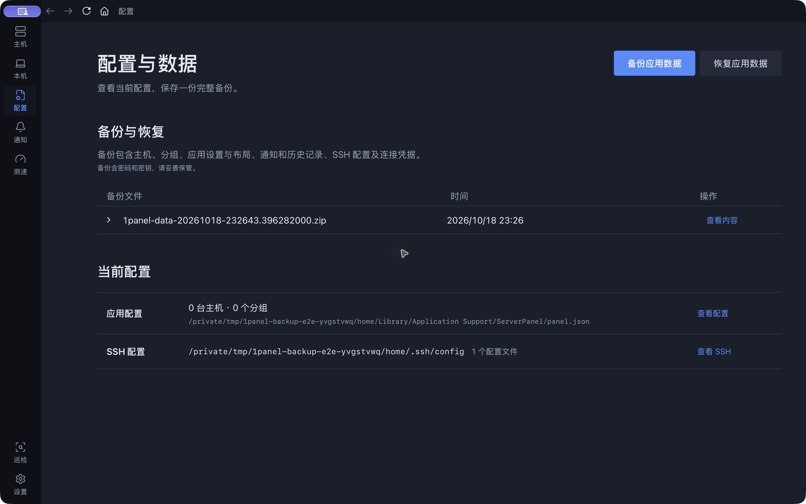
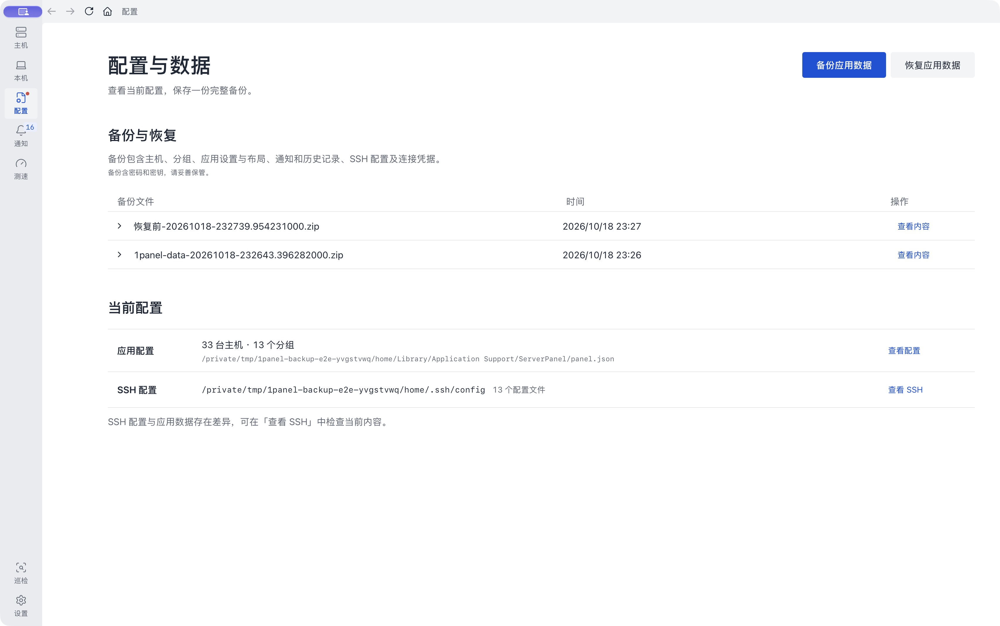

# 完整备份与恢复实测

结果：通过。验证使用本机原生 Wails 窗口和现有数据的隔离副本，未对现有应用执行恢复。

## 实际流程

1. 只读取得现有数据副本：31 台主机、12 个分组、应用偏好、历史记录及 SSH 文件。
2. 测试副本使用独立 HOME、WebKit 身份及单实例锁，并由 macOS 写入规则阻止写入原数据目录。已实际验证该规则拒绝写入；测试界面运行时禁止网络访问。
3. 在测试副本添加 2 台本地认证用主机和 1 个测试分组，从原生「备份应用数据」按钮导出完整 ZIP。
4. 退出测试副本，清空其主机、历史和 SSH 密钥，并把偏好改成深色、18 号字体。重新启动，界面确认 0 台主机、0 个分组。
5. 从原生「恢复应用数据」选择刚导出的 ZIP，预览后确认恢复；应用确实退出并以新进程启动，完成待恢复文件应用及原生偏好确认。
6. 对恢复后的数据逐项核对，并使用应用的连接参数解析及 SSH 连接器，在本地临时 SSH 服务完成恢复后的测试密钥及密码认证。

## 核对结果

| 内容 | 结果 |
| --- | --- |
| 原有主机与分组 | 31 台主机、12 个分组及连接参数、密码、密钥引用全部一致 |
| 应用文件 | 核对 744 个文件，其中 118 个 JSON；持久化内容一致 |
| 设置与布局 | 21 个偏好键恢复；20 个稳定值一致，性能统计键随运行正常更新；恢复前新增的测试偏好已移除 |
| 测速记录 | 27 条，完整内容一致 |
| 告警记录 | 24 条，完整内容一致 |
| 网络历史 | 15 组，完整内容一致 |
| 应用运行历史 | 原有记录全部保留；测试应用恢复后正常新增一次运行记录 |
| SSH | 18 个打包文件核对通过，含 16 个原有配置及凭据文件、2 个测试密钥文件；凭据按字节比对 |
| 认证 | 恢复后的测试密钥和测试密码分别通过本地 SSH 认证；原有远程凭据未用于登录远程服务器 |
| 自动安全备份 | 验证恢复前的空主机、深色设置均保存到「恢复前」备份 |
| 原应用 | 746 个原数据文件保留，745 个字节不变；仅正常运行心跳更新。93 个原 SSH 文件全部不变，设置及安装的程序不变 |

重启后的正常写入单独核对：主配置的 revision / updatedAt、一次新增运行记录、适配屏幕后的窗口宽高、性能统计。主机和凭据不因这些运行写入而变化。

测试源代码仅通过临时编译覆盖改变测试应用身份和标题；备份、预览、暂存、应用、前端恢复代码均使用当前实现。测试启动器让重启继续保留隔离 HOME 与写入保护。

## 清理与复核

清理时窗口工具在测试副本退出后意外重新启动过一次测试应用。已立即停止；主机配置及 SSH 未改变。该次测试运行记录已由原应用的正常心跳重写清除，窗口文件已从测试前快照按字节恢复。最终检查确认无多余运行记录、无待恢复任务，原有设置与数据保持原状。临时应用、包含凭据的测试副本和归档均在结束后清理。

补充自动化验证：3 个后端应用级用例、4 个归档与回滚用例、3 个前端偏好用例（10 个断言）全部通过，包括损坏备份、预览变化、符号链接、写入失败回滚和偏好确认失败回滚。

[结构化结果](backup-restore-results.json)

清空后的隔离副本：

恢复并重启后的隔离副本（含 2 台测试主机）：

